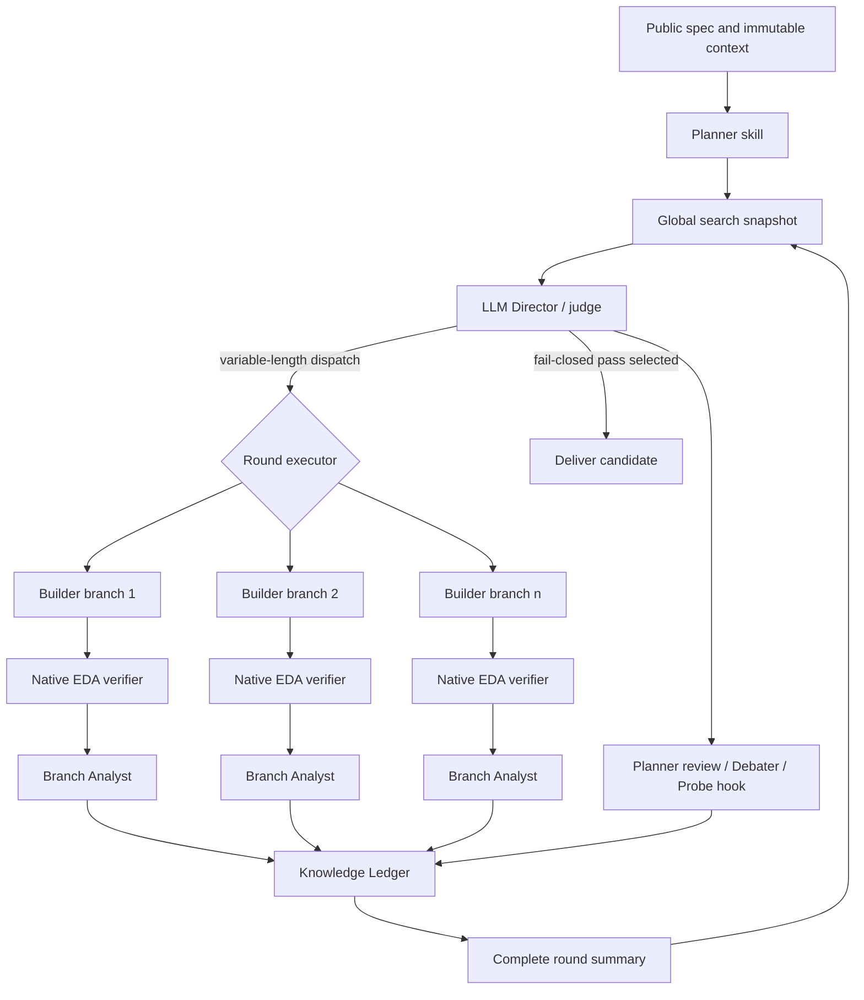

# BW-RTL adaptive loop v1

## Implemented control loop



The first Planner call returns a semantically adequate number of plans, not a
requested count.  On every later round the Director sees all plans, all retained
candidate nodes, bounded EDA evidence, branch reviews, shared knowledge, and all
events from the preceding round.  It emits any finite number of action cards.
The runtime executes every legal card; it never truncates that list to K.

## Role authority

| Role | LLM judgement | Forbidden authority |
|---|---|---|
| Planner | enumerate interpretations; review spec; replan | write RTL; schedule branches |
| Builder | implement seed/refine/fork/fuse obligations | alter spec/context; select next action |
| Verifier | none in v1 native path; normalize EDA facts | edit RTL; infer hidden correctness |
| Analyst | diagnose one branch from code delta and EDA | edit RTL; prune or schedule globally |
| Debater | compare named branches and expose conflict | edit/fuse code; make final decision |
| Director | assess uncertainty; choose topology and dispatch | write RTL; invent evidence |

The repository-local skill at `skills/bw-rtl/` defines these roles.  Runtime
prompts combine the shared skill body with exactly one role reference.  The
skill contains no benchmark ID or known repair.

## Action space

- `seed_plan`: implement a previously untested plan.
- `refine`: apply one bounded evidence-grounded correction.
- `fork`: explore a genuinely different explanation.
- `review_spec`: ask Planner to resolve a public-contract ambiguity.
- `replan`: replace an invalidated implementation hypothesis.
- `probe`: optional public-verification hook; not configured in the current
  CVDP live adapter.
- `discuss`: ask Debater to compare at least two named branches.
- `fuse`: ask Builder to combine named, complementary source candidates.
- `backtrack`: reactivate a verified ancestor and mark the failed descendant.
- `park`: retain a branch without scheduling it in the current round.
- `prune`: close named branches with an explicit evidence-based rationale.
- `stop`: deliver one fail-closed passing candidate, or stop without claiming
  correctness when the search is exhausted or infrastructure is unavailable.

Each non-stop action carries a hypothesis, bounded obligation, expected
observation, falsifier, and optional evidence/knowledge references.  Scripts
validate those fields and references but do not rank their semantic merit.

## Structured information sharing

The Knowledge Ledger stores typed claims rather than conversation transcripts:
spec constraints, observed facts, inferred root causes, supported fix patterns,
rejected hypotheses, conflicts, reusable artifacts, and open questions.  Every
proposal has scope, provenance, confidence, and EDA evidence references.

Deterministic code verifies that references exist, deduplicates exact normalized
claims, and enforces legal status transitions.  It never promotes a semantic
inference on its own.  The Director may mark claims supported, refuted,
conflicting, or superseded; explicit conflicts remain visible to later rounds.

## Script/model boundary

Deterministic code performs only:

- immutable task/candidate contracts and target-path checks;
- strict JSON/schema and ID-reference validation;
- candidate hashing and exact claim deduplication;
- thread scheduling, branch-local exception isolation, and checkpoints;
- native compile/elaboration/simulation and fail-closed evidence normalization;
- legal park/prune/backtrack/stop state transitions.

LLMs perform:

- ambiguity and difficulty assessment;
- plan enumeration and revision;
- RTL generation, focused repair, alternative exploration, and fusion;
- branch diagnosis and hypothesis formation;
- cross-branch debate and global dispatch decisions;
- semantic knowledge promotion/refutation decisions.

## Run one CVDP validation task

The command below is a live paid run.  API credentials remain environment
variables and are not written into arguments or repository files.

```bash
export DEEPSEEK_API_KEY='<key>'
docker compose -f compose.ace-rtl.yaml run --rm ace-rtl-agentic \
  /opt/ace-rtl-venv/bin/python3 -m ace_cvdp_native.rtl_search.adaptive_live \
  --workspace /workspace/ace \
  --cvdp-repo /workspace/ace/external/cvdp_benchmark \
  --dataset /workspace/ace/datasets/cvdp-benchmark-dataset/cvdp_v1.1.0_agentic_code_generation_no_commercial.jsonl \
  --cid cid003 \
  --id cvdp_agentic_dynamic_equalizer_0001 \
  --physical-workers 4 \
  --max-rounds 12 \
  --evaluator-seed 1
```

`--physical-workers` changes latency only.  `--max-rounds` is an operational
fail-safe against an invalid/non-terminating Director, not a breadth choice or
candidate ranking policy.

## Validation status and limitations

- skill structure validation passes;
- deterministic mechanism tests cover variable dispatch width, true concurrent
  Builder execution, sibling-result sharing, debate, knowledge promotion and
  conflict, checkpointing, branch-local role failure, and fail-closed stop;
- the full BW-RTL suite passes without an API call;
- native CVDP evaluation is serialized because its processor mutates process
  environment variables; LLM work in other branch pipelines can overlap it;
- the live adapter currently advertises no `probe` action because generated
  directed tests/assertions are not yet connected to a sound public EDA path;
- no live effectiveness or token-efficiency claim follows from these mechanism
  tests.  Validate first on the selected cid003 task, then on held-out tasks
  without modifying the skill.
