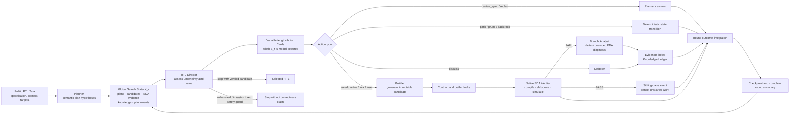
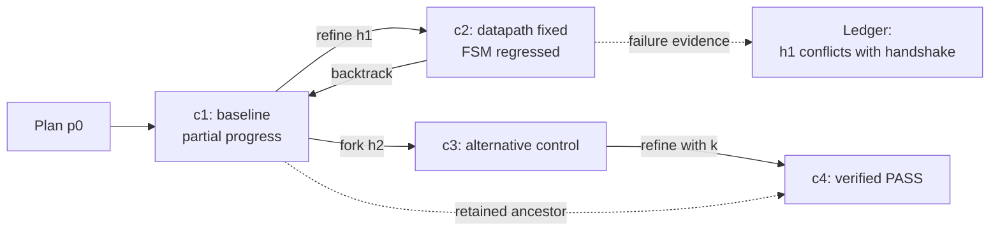

# BW-RTL：动态宽度—深度协同搜索的实现与论文方法说明

> 文档状态：implementation-grounded method draft，2026-08-30  
> 代码真值：`skills/ace-rtl/scripts/ace_cvdp_native/rtl_search/adaptive_*.py` 与
> `skills/bw-rtl/`。本文只把已经实现的机制写成事实；尚未完成的泛化实验和未来优化会明确标注。

Paper-facing execution evidence includes the
[ChipVerilog MIPS16 core-top case study](case_studies/CHIPVERILOG_MIPS16_CORE_TOP_CASE_STUDY.md),
which demonstrates width-one allocation followed by evidence-triggered stopping.

## 1. 方法定位

BW-RTL 将 ACE-RTL 式固定并行采样与固定深度修复，改写为一个由全局
`RTL-Director` 控制的、按轮次运行的动态搜索过程。核心变化不是增加一个普通的
Coordinator，而是把每轮测试时计算的拓扑选择显式化：Director 根据当前所有计划、
候选、EDA 证据、分支诊断和共享知识，决定本轮应当：

- 扩展多少个语义不同的并行分支；
- 对哪些分支继续纵向修复；
- 何时重新审查规格、重规划、比较或融合分支；
- 何时回退到祖先状态、暂存或剪枝；
- 何时基于 fail-closed 的验证证据停止。

因此，每轮的逻辑宽度由模型按实例和反馈动态决定，而不是预先固定为 $K$。
`physical_workers` 只限制同时运行的物理线程数；它不参与候选选择，也不会截断
Director 返回的动作列表。

## 2. 问题形式化

### 2.1 不可变任务契约

对一个 RTL 任务，系统构造不可变任务契约

\[
\mathcal{T}=(S, C, F),
\]

其中 $S$ 是公开规格，$C$ 是不可修改的公开上下文，$F$ 是必须生成的目标文件
集合。任何候选都必须完整生成 $F$ 中的文件，不得生成未声明路径。候选被表示为
不可变文件集合，并由文件路径和内容计算 SHA-256 的前 16 个十六进制字符
（64 bit）作为标识。

### 2.2 全局搜索状态

第 $r$ 轮开始时，Director 接收结构化搜索快照

\[
\mathcal{X}_r=(\mathcal{P}_r,\mathcal{C}_r,\mathcal{E}_r,
\mathcal{K}_r,\mathcal{H}_{r-1}),
\]

其中：

- \(\mathcal{P}_r\)：Planner 产生的实现计划及其区分性假设和外部不变量；
- \(\mathcal{C}_r\)：所有保留候选、父节点、状态、候选哈希和分支诊断；
- \(\mathcal{E}_r\)：与候选绑定的编译、展开、仿真或 PASS 证据；
- \(\mathcal{K}_r\)：证据链接的 Knowledge Ledger；
- \(\mathcal{H}_{r-1}\)：上一轮所有动作的完成、取消、拒绝或错误事件。

Director 输出

\[
\mathcal{D}_r=(Q_r,\mathcal{A}_r,\mathcal{U}_r),
\]

其中 $Q_r$ 是对规格确定性、计划集中度、实现风险和验证可观测性的定性评估，
\(\mathcal{A}_r\) 是可变长度动作集合，\(\mathcal{U}_r\) 是对共享知识状态的更新。
本轮逻辑宽度为

\[
B_r=|\mathcal{A}_r|,
\]

而不是预设常数。当前实现没有显式训练或计算一个标量 value function；“计算价值”
由 Director 根据证据、假设区分能力和冗余程度做结构化定性判断。

### 2.3 候选搜索图

候选不是被原地覆盖的单条修复链，而是带父节点的有向无环搜索图。`refine` 和
`fork` 产生单父节点子代，`fuse` 可以产生多父节点子代。旧候选、证据和状态继续
保留，因此系统可以回到某个候选祖先或原始计划，而不必依赖模型重新生成历史版本。

## 3. 系统角色与权限边界

| 组件 | 输入 | 输出 | 明确禁止 |
|---|---|---|---|
| Planner | 公开规格、不可变上下文、已有计划、共享知识 | 一个或多个语义不同的计划；规格审查或重规划结果 | 写 RTL、调度分支 |
| RTL-Director | 公开规格、完整结构化搜索快照 | 任务评估、可变长度 Action Cards、知识状态决策 | 写 RTL、伪造证据 |
| Builder | 任务契约、选中计划、动作义务、父候选、相关知识 | 完整 RTL 候选 | 改规格、选择下一动作、写测试 |
| Verifier | 冻结候选、公开 evaluator 配置 | 规范化 EDA 证据 | 修改 RTL、推断隐藏正确性 |
| Analyst | 候选差分、计划、动作、EDA 证据、相关知识 | 单分支诊断和知识提案 | 编辑 RTL、全局调度 |
| Debater | 被点名的多个分支及其公开证据 | 公平比较、冲突和判别建议 | 融合代码、剪枝、最终决策 |
| Knowledge Ledger | 带证据引用的结构化提案 | 可验证来源的共享语义记忆 | 自动判定语义真伪 |

Verifier 在当前 CVDP 路径中不是 LLM Agent，而是确定性的 EDA 执行边界。可选的
`probe` 动作已包含在通用接口中，但当前 live adapter 没有接入可靠的公开 probe
生成与验证路径，因此运行时不向 Director 暴露该动作。

## 4. 动态动作空间

每个非 `stop` 动作必须包含：唯一 `action_id`、语义假设、边界明确的工作义务、
预期观察、证伪条件，以及可选的 evidence/knowledge 引用。这使并行采样成为可解释的
假设检验，而不是没有标签的重复 sampling。

| 动作 | 作用 | 来源约束 |
|---|---|---|
| `seed_plan` | 首次实现一个尚未测试的计划 | 不允许候选父节点 |
| `refine` | 对一个候选实施一次证据约束的局部修复 | 恰好一个候选 |
| `fork` | 从计划或候选探索实质不同的解释 | 至多一个候选 |
| `review_spec` | 让 Planner 重新解析公开契约中的歧义 | 不产生 RTL |
| `replan` | 在假设失效后产生新的语义计划 | 不产生 RTL |
| `probe` | 请求能区分假设的公开验证观察 | 恰好一个候选；live CVDP 未启用 |
| `discuss` | 让 Debater 比较互相冲突的分支 | 至少两个候选 |
| `fuse` | 合并多个分支中证据支持的互补部分 | 至少两个候选 |
| `backtrack` | 标记有害后代并重新激活其祖先 | 源节点和祖先目标各一个 |
| `park` | 保留分支但本轮不继续投入计算 | 至少一个候选 |
| `prune` | 用显式证据关闭分支 | 至少一个候选 |
| `stop` | 交付一个已 PASS 候选，或无正确性声明地停止 | 至多一个候选 |

确定性代码检查所有节点、计划、证据和知识引用是否存在，并拒绝重复语义动作、非法
祖先回退、混合了其他动作的 `stop`、以及没有 fail-closed PASS 证据的正确性停止。

## 5. 每轮执行过程

### 5.1 初始化

Planner 首先依据语义不确定性产生一个或多个计划。简单明确的规格可以只产生一个计划；
只有会导致不同实现或不同验证行为的冲突解释才应形成多个计划。脚本不要求固定计划数，
但会拒绝重复 `plan_id` 和完全相同的计划摘要。

### 5.2 Director 决策

Director 观察完整 frontier 和上一轮结果，判断更有价值的是横向探索还是纵向修复：

- 当一个根因占优且故障已被定位时，派发一个 `refine`；
- 当存在互不兼容的协议、时序、状态或算术解释时，保留或创建多个分支；
- 当连续修改不能区分根因时，优先 `review_spec`、`replan` 或 `discuss`；
- 当后代出现功能回退时，`backtrack` 到引入有害假设之前的祖先；
- 只有证据支持互补性时才 `fuse`；
- 对暂时劣势但尚未证伪的分支使用 `park`，而不是不可逆删除。

### 5.3 并发执行与分支流水线

合法动作分为两类：

1. `park/prune/backtrack` 立即执行确定性状态转移；
2. Builder、Planner revision、Debater 或 Probe 动作提交到线程池。

若本轮有 $B_r$ 个可执行动作、物理 worker 数为 $W$，线程池以最多 $W$ 个并发
流水线执行全部动作；当 (B_r>W) 时其余动作排队，但不会因为 worker 不足而被截断。

候选生成流水线为：

\[
\text{Builder}\rightarrow\text{Contract Check}\rightarrow
\text{Native Verifier}\rightarrow\text{Analyst if failed}.
\]

Builder 失败、Verifier 失败或 Analyst 失败被隔离在本分支，其他 sibling 继续执行。
缺失目标文件或出现额外目标文件时，候选被标记为本地契约不完整，不进入正常功能判断。
基础设施失败和 RTL 候选失败被明确区分，基础设施失败不会被解释为候选质量下降。

### 5.4 sibling PASS 的提前收敛

当任一候选获得完整的 fail-closed PASS 证据时，共享事件立即置位：

- 尚未开始的 sibling 动作在启动前取消；
- 已失败分支若尚未开始 Analyst 调用，则跳过该诊断；
- 已经进入 Builder、EDA 或 Analyst 的工作不会被强制中断；
- 本轮已完成的证据仍被合并，最终交付必须由下一次 Director `stop` 决策完成。

这一机制减少“已经找到正确候选后仍继续反思失败 sibling”的冗余开销，同时保留
Director 作为唯一全局停止决策者。

### 5.5 回合屏障与检查点

普通失败证据采用 round-level feedback：本轮所有已启动动作完成后，系统统一整合候选、
证据、诊断、知识提案和事件，再调用下一轮 Director。除 sibling PASS 事件之外，当前
实现不会在单轮尚未结束时根据某个普通失败结果重新调度。因此它是“逐轮动态”，不是
完全异步的 event-driven scheduler。

每轮结束均持久化 `adaptive_state.json`；终态还写入候选、验证证据、角色调用台账、
运行配置、选中 RTL 和总结果，便于恢复、审计和计算量统计。

## 6. 证据与共享知识

### 6.1 Fail-closed EDA 证据

Verifier 将公开 evaluator 输出规范化为：

- `INFRASTRUCTURE`：环境或工具错误；
- `INCOMPLETE`：候选文件契约或本地预检查不完整；
- `COMPILE` / `ELABORATE` / `SIMULATION`：对应阶段失败；
- `PASS`：所有记录的公开子测试通过。

只有 `PASS` 能支持正确性停止。公开测试通过仍只表示当前 evaluator 下的证据，不被
表述为隐藏测试或完整规格正确性的证明。

### 6.2 Knowledge Ledger

Ledger 存储语义 claim，而不是多轮聊天 transcript。知识类型包括：
`spec_constraint`、`observed_fact`、`root_cause`、`fix_pattern`、
`rejected_hypothesis`、`conflict`、`reusable_artifact` 和 `open_question`。

每条知识带有作用域（global、plan family、module 或 candidate lineage）、来源角色、
来源 ID、置信度和 EDA evidence refs。状态为 `proposed`、`supported`、`refuted`、
`conflicting` 或 `superseded`。脚本只验证引用、去重和合法状态转移；Analyst/Debater
只能提出知识，只有 Director 可以改变其语义状态。互相冲突的知识不会被静默覆盖。

## 7. 对两个核心失败模式的处理

### 7.1 Functional Regression

BW-RTL 不在单个文件上反复覆盖，而是通过以下机制保留可恢复性：

1. 每个候选内容不可变，并由 hash 标识；
2. 每次修改生成新节点并记录父节点，不破坏已验证祖先；
3. 每个节点保存独立 EDA 证据和产生它的动作；
4. Director 可 `fork` 保留替代假设、`park` 暂存候选、`backtrack` 恢复祖先；
5. `fuse` 明确记录多个来源，而不是无来源地拼接修改；
6. 成功交付需要 fail-closed PASS，模型主观判断不能覆盖验证结果。

因此，局部修复导致 FSM、协议或数据通路回退时，错误后代不会不可逆地污染整条轨迹。

### 7.2 Context Degradation

系统不把所有历史 RTL、编译日志和自然语言对话不断拼接到同一上下文，而采用结构化、
按角色裁剪的信息共享：

- Director 接收候选摘要、结构化诊断和有界 EDA 反馈，而不是完整聊天记录；
- Analyst 接收相对父候选的 unified diff；根节点才接收完整候选；
- 候选差分上限为 50,000 字符，Director 中的长 EDA feedback 被首尾截断到约
  5,500 字符，Analyst 的 EDA 输入上限为 6,000 字符；
- Builder/Analyst 优先接收动作显式引用的知识；未指定时只接收
  `supported/conflicting` 项；
- Planner revision 重新获得公开规格和不可变上下文，避免只根据陈旧诊断重写计划；
- rejected、conflicting 和 superseded 状态显式保留，防止旧结论伪装成当前事实。

这一设计缓解而非彻底消除上下文退化：随着候选和证据数量增长，Director 的全局快照
仍会增长；当前实现尚未加入分层摘要、长期/短期记忆分区或基于 token 的上下文预算器。

## 8. 确定性运行时与 LLM 决策的边界

### 8.1 LLM 负责

- 识别规格歧义和实现风险；
- 生成或修订语义计划；
- 写 RTL、局部修复、替代探索和融合；
- 诊断失败并形成可证伪假设；
- 比较冲突分支；
- 选择本轮宽度、深度、回退、暂停、剪枝和停止。

### 8.2 确定性代码负责

- 保护任务、目标路径和候选不可变契约；
- 解析严格 JSON 并验证 ID/引用；
- 拒绝重复动作和非法状态转移；
- 计算候选 hash、去重完全相同的知识 claim；
- 调度线程、隔离分支异常、处理 sibling PASS 事件；
- 执行公开 EDA 并规范化 fail-closed 证据；
- 记录调用、token、候选、事件和检查点。

脚本不会用手写分数替代 Director 的语义选择，也不会在 Director 给出多个动作后只保留
top-$K$。

## 9. 算法伪代码

```text
Input: public task contract T, physical worker limit W, safety guard R_max
Output: verified candidate or a non-correctness terminal status

P <- Planner.propose(T)                    # variable number of semantic plans
C, E, K, H <- empty

for round r = 1 ... R_max:
    X_r <- Snapshot(P, C, E, K, H)
    D_r <- Director.decide(T.spec, X_r)
    ValidateSchemaAndReferences(D_r)
    K <- ApplyDirectorKnowledgeDecisions(K, D_r)

    if D_r contains STOP:
        require STOP is the only action
        if a candidate is selected:
            require candidate has fail-closed PASS evidence
            return candidate
        return stopped_without_correctness

    apply PARK / PRUNE / BACKTRACK state transitions
    submit every other legal action to a W-worker executor

    for each candidate-producing action in its branch pipeline:
        if a sibling already passed before start: cancel action
        candidate <- Builder(action, plan, parents, relevant knowledge)
        evidence  <- ContractCheckAndNativeVerify(candidate)
        if evidence is PASS: set sibling_passed event
        else if evidence is not infrastructure failure and no sibling has passed:
            review <- Analyst(candidate delta, evidence, relevant knowledge)

    wait for all started actions in the round
    C, E, K, H <- IntegrateAllCompletedOutcomes()
    Checkpoint(C, E, K, H, D_r)

return safety_limit                            # no correctness claim
```

## 10. CVDP/ACE-RTL 适配实现

live adapter 每次只运行一个指定 CVDP datapoint，并执行以下隔离：

1. 清空 reference patch、历史 response 和 subjective reference；
2. 从公开 prompt、初始公开目标内容和非目标上下文构造 `TaskContract`；
3. Planner、Builder、Analyst、Director 和 Debater 通过 ACE 的模型调用接口执行，并将
   每次调用及 token telemetry 写入统一 ledger；
4. Builder 输出经过路径规范化和 SystemVerilog 高置信度预检查；
5. 冻结候选通过 `PrebuiltCandidateModel` 注入原生 CVDP processor，不发生额外生成；
6. evaluator 使用固定 `COCOTB_RANDOM_SEED`，并把基础设施问题与候选失败分离；
7. 原生 CVDP processor 会修改进程级环境变量，因此当前 EDA 区域由锁串行化；其他
   Builder/Analyst 流水线仍可并发。

当前默认模型为 `deepseek-flash`（DeepSeek-V4.1-Flash 的 API ID）；各角色模型、单次最大输出、物理 worker、evaluator seed
和 round safety guard 都由命令行/环境配置记录。`max_rounds` 是防止失控的操作保护，
不是算法预先分配的修复深度。

## 11. 论文方案部分可用表述

下面文字可作为 Method 初稿，后续可按目标会议风格压缩。

### 11.1 Overview

我们提出 BW-RTL，一个基于全局证据状态的动态多智能体 RTL 搜索框架。不同于在执行前
固定并行候选数与修复轮数，BW-RTL 在每个搜索回合中由 RTL-Director 联合决定横向探索
宽度与纵向修复深度。系统将每个实现保存为不可变候选节点，并将编译、展开和仿真结果
绑定到相应节点，从而把 RTL 调试表示为可回退、可分叉和可融合的搜索图，而不是不可逆
的单条编辑轨迹。

### 11.2 Adaptive global scheduling

在第 $r$ 轮，Director 观察计划集合、候选 frontier、EDA 证据、分支诊断、共享知识以及
上一轮动作结果。它输出一个可变长度动作集合，每个动作显式描述待检验假设、工作义务、
预期观察和证伪条件。该动作集合可以集中于一个高价值修复，也可以扩展多个互斥解释，
还可以触发规格审查、分支比较、融合或回退。因此，测试时计算的宽度 $B_r$ 和实际搜索
深度由当前实例及其反馈共同决定，而不由固定 (K\times T) 调度预先确定。

### 11.3 Evidence-grounded branch execution

每个候选动作依次经过 Builder、不可变契约检查、原生 EDA Verifier 和失败分支 Analyst。
Verifier 是非生成式、fail-closed 的执行边界，只有完整公开测试 PASS 才能支持成功停止。
Analyst 只能根据候选差分和 EDA 证据提出诊断，不能修改 RTL 或选择全局动作。所有分支
结果在回合末合并，Director 再依据更新后的全局状态重分配后续计算。

### 11.4 Backtracking and structured memory

BW-RTL 保留每个候选及其父节点，使局部修复不会覆盖先前正确行为。当新编辑造成回退时，
Director 可以恢复最近的可靠祖先、保留替代分支或融合互补实现。为避免长程交互中的上下文
污染，系统使用证据链接的 Knowledge Ledger 替代原始对话历史，并按角色提供候选差分、
有界 EDA 摘要和相关语义 claim。该结构同时保留被拒绝假设和未解决冲突，使后续决策能够
区分观察事实、根因推断与过时反馈。

## 12. 论文主流程图

### 12.1 Mermaid 原型

可独立渲染的源文件为 [`figures/bw_rtl_main_flow.mmd`](figures/bw_rtl_main_flow.mmd)。



### 12.2 推荐的论文绘图布局

建议将主图画成横向四区结构，而不是把所有 Agent 画成平级聊天气泡：

1. **Input and State（左）**：公开任务、Planner、Global Search State；
2. **Global Control（中上）**：突出 RTL-Director 和 variable-length Action Cards；
3. **Parallel Execution（中下）**：画 2–3 条代表性 branch lanes，每条为
   Builder → Contract Check → Verifier → Analyst；用省略号表示宽度可变；
4. **Evidence Feedback（右）**：Knowledge Ledger、Round Integration、Checkpoint，粗回边
   返回 Global Search State；PASS 旁路连接早停事件和最终输出。

视觉编码建议：

- 蓝色：LLM 决策角色（Planner、Director、Builder、Analyst、Debater）；
- 绿色：确定性验证和 PASS 路径；
- 橙色：结构化状态、Knowledge Ledger 和回合反馈；
- 灰色：契约检查、并发执行器、检查点等运行时；
- 红色虚线：failure evidence、backtrack 和冲突；
- 实线粗回边：跨轮动态调度；
- 在 Action Cards 旁直接标注 (B_r=|\mathcal{A}_r|)，在执行器旁标注
  “$W$: physical concurrency only”。

### 12.3 推荐图注

**中文：** BW-RTL 的证据驱动动态 RTL 搜索。RTL-Director 在每轮基于完整结构化搜索
状态输出可变长度动作集合，联合决定并行探索宽度和顺序修复深度。候选以不可变搜索图
保存并由原生 EDA fail-closed 验证；失败诊断和跨分支比较被压缩为带证据引用的共享知识，
供下一轮重新分配测试时计算。物理 worker 数只影响延迟，不限制逻辑搜索宽度。

**English:** *Overview of BW-RTL. At each round, an RTL-Director observes the
global structured search state and emits a variable-length set of evidence-grounded
actions, jointly adapting parallel exploration and sequential repair. Immutable
candidate branches are verified by a fail-closed native EDA boundary, while
branch diagnoses and cross-branch conflicts are consolidated into an
evidence-linked knowledge ledger for the next scheduling decision. The worker
count limits physical concurrency only, not the logical search width.*

## 13. 辅助图：回退与非单调调试

可独立渲染的源文件为
[`figures/bw_rtl_backtracking_flow.mmd`](figures/bw_rtl_backtracking_flow.mmd)。



这张图适合放在 Motivation 或 Method intuition 中，强调修复不是单调过程，候选祖先必须
保留。图中的具体 FSM/datapath 文字是概念示例，不应被表述为已测量的普遍统计结果。

## 14. 当前实现文件映射

| 文件 | 论文对应模块 |
|---|---|
| `skills/bw-rtl/SKILL.md` | 总体角色协议和 round loop |
| `skills/bw-rtl/references/*.md` | Planner、Director、Builder、Analyst、Debater、Verifier 和 Ledger 权限 |
| `adaptive_contracts.py` | Action Cards、评估、候选、证据、快照和结果 schema |
| `adaptive_engine.py` | 动态回合、线程并发、取消、状态转移、停止和 checkpoint |
| `adaptive_ace_adapter.py` | 各 LLM 角色 prompt、严格解析、候选差分和调用记录 |
| `adaptive_roles.py` | 可替换角色接口 |
| `knowledge.py` | 知识类型、作用域、状态和证据引用验证 |
| `contracts.py` | 不可变任务与候选契约 |
| `cvdp_adapter.py` | 数据清洗、原生 CVDP fail-closed Verifier |
| `adaptive_live.py` | 单任务运行入口、模型/预算配置和持久化 |
| `test_adaptive_rtl_director.py` | 动态调度、并发、回退、知识和停止机制测试 |
| `test_adaptive_ace_adapter.py` | prompt、schema、上下文隔离与 adapter 测试 |

## 15. 已实现、已验证与尚未实现的边界

### 已实现并通过确定性测试

- 可变长度 Director dispatch，不设置算法 branch width 或 selection $K$；
- 多分支 Builder 流水线、完整回合汇总和 branch-local error isolation；
- sibling PASS 后取消未开始动作并跳过尚未开始的失败分支 Analyst；
- seed/refine/fork/fuse/backtrack/park/prune/stop 等状态和引用校验；
- 结构化 Knowledge Ledger、冲突保留和 Director 所有的状态更新；
- 不可变 target/candidate 契约、原生 CVDP 验证和完整调用台账；
- 当前仓库目标测试：62 passed，另有 2 个 subtests passed。

### 已有选择性运行证据

- `dynamic_equalizer_0001`：两种实质不同 LMS 计划、2 个候选、2 次 Verifier、7 次
  LLM 调用后 PASS；该结果支持“本样例中横向语义探索优于沿错误计划持续纵向修复”。
- `binary_to_gray_0003`：单计划、单候选 PASS，但 Planner/Director 开销表明简单任务仍需
  更轻量的 fast path。
- `cache_controller_0001`：固定 evaluator seed 1 下，3 个 Director rounds、2 个候选、
  2 次 Verifier、7 次 LLM 调用和 51,158 reported tokens 后 PASS。
- `DES_0001`：两个候选均停留在 compile failure；第 1 轮 Analyst 输出耗尽上限，
  第 3 轮 Director 未返回最终内容，运行以 `director_error` 终止。该轨迹共 2 次
  Verifier、8 次 LLM 调用和 130,543 reported tokens，不能产生正确性结论。

对应的持久化证据分别位于：

- [`dynamic_equalizer` adaptive result](../artifacts/experiment/bw_vs_ace_cid003_dynamic_equalizer_20260829T081231Z/ADAPTIVE_RESULT.json)；
- [`binary_to_gray` result](../outputs/cvdp_adaptive_rtl_search_cid003_cvdp_v1.1.0_agentic_code_generation_no_commercial_20260830T132350Z/result.json)；
- [`cache_controller` result](../outputs/cvdp_adaptive_rtl_search_cid003_cvdp_v1.1.0_agentic_code_generation_no_commercial_20260830T132351Z/result.json)；
- [`DES` result](../outputs/cvdp_adaptive_rtl_search_cid003_cvdp_v1.1.0_agentic_code_generation_no_commercial_20260830T132515Z/result.json)。

这些结果只能作为 case study 和初步效率证据。hard slice 的控制器终止也表明当前系统
尚未达到稳定泛化，因此不能据此声称 BW-RTL 在 CVDP 上整体优于 ACE-RTL。

### 当前限制与下一版优化

1. **没有全局标量预算器。** Director 定性判断价值，但没有显式 token/latency utility、
   剩余预算状态或学习到的 stopping value。
2. **普通反馈是 round-level。** 单轮失败不会即时打断并重排其他已运行分支；只有 PASS
   事件有有限的回合内取消能力。
3. **easy-task fast path 尚未实现。** 对高规格确定性、低风险任务仍需两次 Director 调用。
4. **Probe 未接入 live evaluator。** 当前无法由系统生成新的可靠判别测试来提高可观测性。
5. **EDA 边界串行。** CVDP processor 的进程级环境修改限制了仿真并发。
6. **Director 上下文仍会增长。** 已采用结构化压缩，但尚无层次化 summary 和 token-aware
   memory eviction。
7. **版本溯源需要加强。** 当前 BW-RTL 目录未绑定 Git commit；正式论文实验应记录源码
   commit 或完整 content hash。
8. **关键角色缺少恢复策略。** 当前 Director 返回空内容或非法结构时，运行 fail-closed
   地终止为 `director_error`，尚未实现有界重试、结构修复或恢复到上一个 checkpoint；
   Analyst 输出耗尽也只记录为 branch-local error。

## 16. 推荐的 claim 边界

方法层面可以声称：

- BW-RTL 实现了实例与反馈条件化的可变宽度、可回退 RTL 搜索；
- 逻辑搜索宽度与物理 worker 数解耦；
- 通过不可变候选图和显式 backtracking 避免不可逆修复轨迹；
- 通过证据链接的结构化共享状态减少原始多轮上下文累积；
- 正确性停止由 fail-closed EDA 证据约束。

当前不应声称：

- 已学习到最优 test-time compute policy；
- 能连续、异步地在任意反馈到达时立即重分配所有计算；
- 消除了所有上下文退化；
- 单个或两个任务已经证明整体优于 ACE-RTL；
- 公开 PASS 等价于隐藏测试或形式化正确性。
